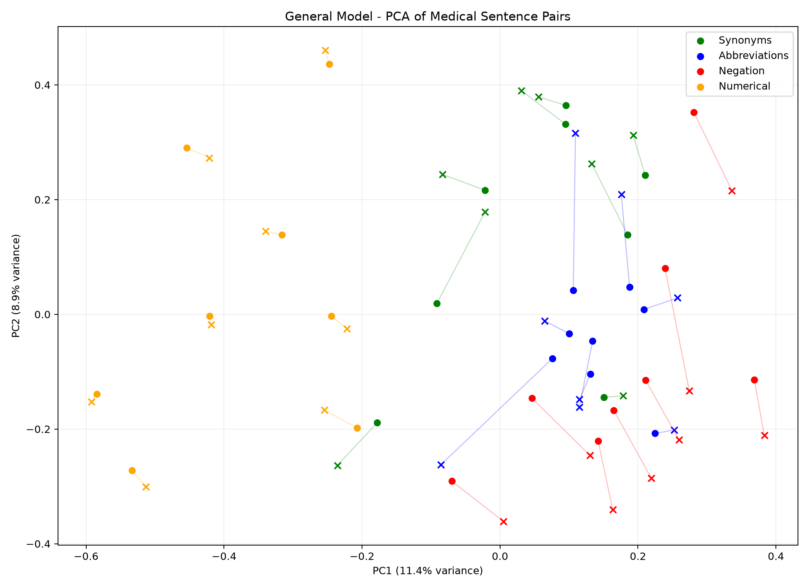
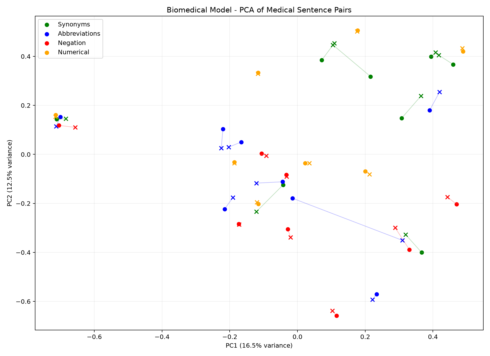

# Medical Embedding Model Evaluation

## Models
- General: all-MiniLM-L6-v2 (384 dimensions)
- Biomedical: NeuML/biomedbert-base-embeddings (768 dimensions)

Total sentence pairs: 32

## Category Results

| Category | General | Biomedical |
|---|---:|---:|
| Abbreviations | 0.6389 | 0.8797 |
| Negation | 0.8132 | 0.9773 |
| Numerical | 0.9155 | 0.9957 |
| Synonyms | 0.7585 | 0.8672 |

## Equivalent vs Different Separation

### General
- Equivalent mean: 0.6987
- Different mean: 0.8644
- Separation: -0.1656

### Biomedical
- Equivalent mean: 0.8735
- Different mean: 0.9865
- Separation: -0.1130

## Interpretation

Higher similarity is desirable for equivalent pairs.
For negation and numerical differences, very high similarity
may indicate difficulty distinguishing clinically different statements.

These results are exploratory and do not establish clinical safety.

## Visualizations

